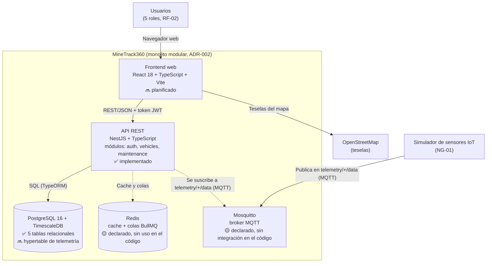

# C4 — Nivel 2: Diagrama de Contenedores

> **Alcance:** las piezas desplegables de MineTrack360 y los protocolos entre ellas.
> **Fuente de verdad:** `SPEC.md` §4 y §7, [ADR-001](../adr/ADR-001-stack-tecnologico.md), [ADR-002](../adr/ADR-002-estilo-arquitectonico.md) y [ADR-003](../adr/ADR-003-persistencia.md).

**Leyenda de estado** (verificado contra el repositorio al 2026-11-13):

| Marca | Significado |
|---|---|
| ✅ | Implementado en el código |
| 🟡 | Declarado en `docker-compose.yml`, pero el código todavía no lo usa |
| 🔜 | Planificado en la SPEC; aún no existe |

## Trazabilidad de contenedores

| Contenedor | Tecnología | Estado | Se justifica en |
|---|---|---|---|
| Frontend web | React 18, TypeScript, Vite, TailwindCSS, Zustand, Leaflet, Recharts | 🔜 (no existe `frontend/`) | `SPEC.md` §4; RF-04, RF-09 |
| API REST | Node.js, NestJS, TypeScript; documentación OpenAPI/Swagger en `/api/docs` | ✅ módulos `auth`, `vehicles` y `maintenance` en `backend/src/` | `SPEC.md` §4; ADR-001; ADR-002 |
| Base de datos | PostgreSQL 16 + TimescaleDB, ORM TypeORM | ✅ tablas `roles`, `user_accounts`, `vehicle_types`, `vehicles`, `maintenance_thresholds`; 🔜 hypertable `TELEMETRY_READING` (hoy solo se habilita la extensión) | `SPEC.md` §4 y §5; ADR-001; ADR-003 |
| Redis | Redis (cache + BullMQ) | 🟡 servicio en `docker-compose.yml`; sin dependencia en `backend/package.json` | `SPEC.md` §4 |
| Broker MQTT | Eclipse Mosquitto | 🟡 servicio y `mosquitto.conf` en el repo; sin cliente MQTT en el código | `SPEC.md` §4 (tópicos `telemetry/+/data`); RF-03 |

## Relaciones entre contenedores

| Origen → Destino | Protocolo | Se justifica en |
|---|---|---|
| Usuarios → Frontend | Navegador web | `SPEC.md` §1 (plataforma web) |
| Frontend → API | REST/JSON con token JWT | `SPEC.md` §4 (API REST) y RF-01 |
| Frontend → OpenStreetMap | Descarga de teselas | `SPEC.md` §4 y RF-04 |
| API → Base de datos | SQL vía TypeORM | `SPEC.md` §4; ADR-003 |
| API → Redis | Cache y colas (BullMQ) | `SPEC.md` §4 |
| API ← Mosquitto | MQTT, suscripción a `telemetry/+/data` | `SPEC.md` §4 y CA-02 |
| Simulador → Mosquitto | MQTT, publicación en `telemetry/+/data` | `SPEC.md` NG-01 y §4 |

## Notas

- **El diagrama documenta decisiones, no código terminado.** Las marcas 🟡 y 🔜 evitan presentar como existente lo que todavía no lo es.
- **Un solo proceso de aplicación:** la API contiene los módulos de dominio (ADR-002). El módulo de Telemetría (RF-03) se mantiene aislado para poder extraerlo más adelante (NG-05), pero hoy no es un contenedor aparte.
- Contexto de más alto nivel: [`C4-contexto.md`](./C4-contexto.md).
