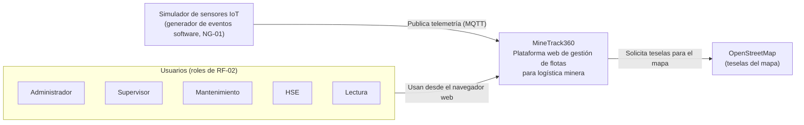

# C4 — Nivel 1: Diagrama de Contexto

> **Alcance:** MineTrack360 como caja negra, quiénes lo usan y con qué sistemas externos se relaciona.
> **Fuente de verdad:** `SPEC.md` (v2) y los ADR en `docs/adr/`. Regla del TP2: si un elemento no figura en la SPEC o en un ADR, no puede figurar en este diagrama.

## Trazabilidad de elementos

| Elemento | Tipo | Se justifica en |
|---|---|---|
| Administrador, Supervisor, Mantenimiento, HSE, Lectura | Persona (actor) | `SPEC.md` RF-02; los 5 roles están sembrados en la migración `1793063543069-CreateAuthTables.ts` |
| MineTrack360 | Sistema | `SPEC.md` §1 (Contexto y Propósito) |
| Simulador de sensores IoT | Sistema externo | `SPEC.md` NG-01 (sin hardware IoT real; los datos se simulan con un generador de eventos software) y RF-03 (ingesta MQTT) |
| OpenStreetMap | Sistema externo | `SPEC.md` §4 (Leaflet/OpenStreetMap) y RF-04 (mapa interactivo) |

## Notas

- **Sin cajas fantasma:** no se dibujan servicios de correo, pagos ni autenticación externa porque la SPEC no los declara.
- **Los sensores reales quedan fuera** (NG-01): el simulador ocupa su lugar en el diagrama. Si en el futuro se integra hardware, se agrega un ADR y se reemplaza este actor.
- El detalle interno del sistema está en [`C4-contenedores.md`](./C4-contenedores.md).
