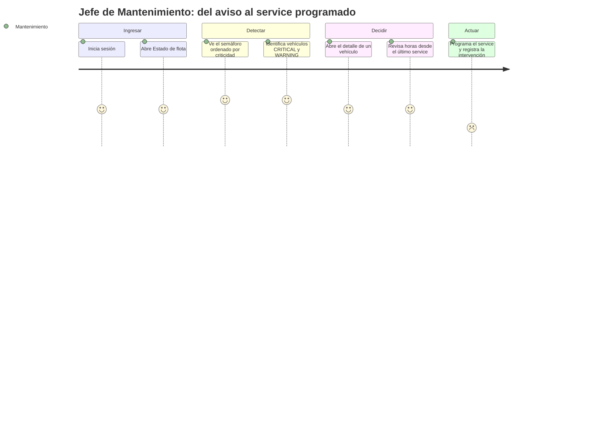
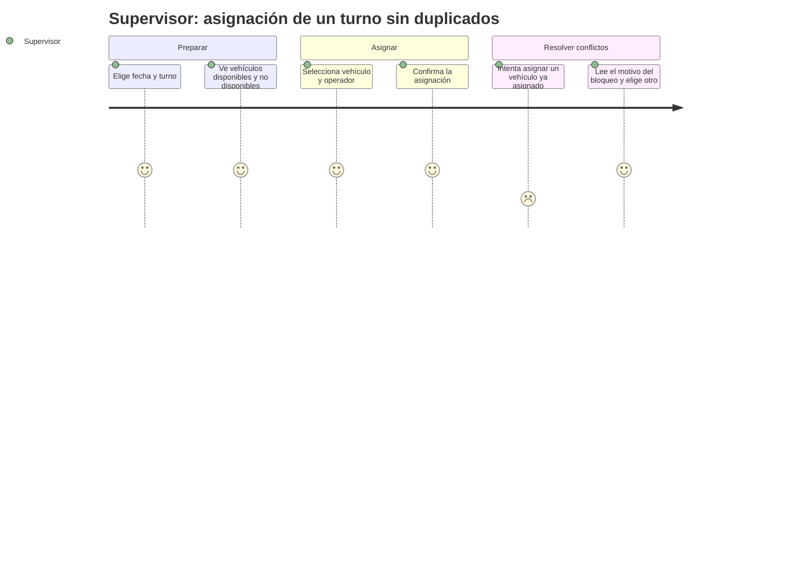

# TP3 — Usuarios, personas y journeys

> **Estado de la evidencia:** el informe de PP2 (§2.3) declara que las entrevistas y la encuesta son **simuladas**. Por eso las personas de este documento son **proto-personas (hipótesis)**, no resultados de investigación con usuarios reales. Cada dato cita su origen en el informe; lo que no tiene origen se marca como *supuesto*. Validarlas con usuarios reales queda como tarea pendiente.
> **Alcance:** solo los roles de las 2 pantallas críticas del TP3 (RF-05 y RF-07). Los demás roles (HSE, Lectura, Administrador) no se modelan acá.

## 1. Pantallas críticas y trazabilidad

| Pantalla | Requerimiento (`SPEC.md`) | Historia de usuario (informe PP2 §2.5) | Rol principal |
|---|---|---|---|
| P1 — Estado de flota y alertas de mantenimiento | RF-05 | HU-02 | Mantenimiento |
| P2 — Asignación de turno | RF-07 | HU-04 | Supervisor |

Acceso real hoy: `POST /api/v1/maintenance/threshold-evaluation` responde 403 a `hse` y `lectura` (verificado en `maintenance.controller.spec.ts`). Por eso P1 se diseña para `admin`, `supervisor` y `mantenimiento`. Si se quisiera que HSE o Lectura vean las alertas, hay que cambiar ese permiso (decisión pendiente, ver riesgos en `SPEC.md` v3).

## 2. Proto-personas

### Persona A — Jefe de Mantenimiento (rol `mantenimiento`)
| Campo | Contenido | Origen |
|---|---|---|
| Objetivo | Programar el service **antes** de la falla | HU-02 |
| Hoy | Se entera por reporte del chofer al fin del turno o cuando el vehículo se detiene; lleva el historial en planillas, a veces desactualizadas | Entrevista 1 (simulada) |
| Necesita ver | Semáforo de estado por vehículo, horas desde el último service | Entrevista 1 |
| Frustración | Alertas que llegan tarde o sin saber cuánto falta | Entrevista 1 |
| Entorno | Taller con conectividad estable | Informe §1.1 |
| Dispositivo | Escritorio o tablet (≥ 768 px) | RNF-06 del informe |
| Habilidad técnica | *Supuesto:* usa planillas de cálculo con soltura | — |

### Persona B — Supervisor de Turno / Despachador (rol `supervisor`)
| Campo | Contenido | Origen |
|---|---|---|
| Objetivo | Asignar vehículo y operador a cada turno sin duplicar | HU-04 |
| Hoy | Pizarra física + grupo de mensajería para avisar cambios | Entrevista 2 (simulada) |
| Frustración | Doble asignación; vehículos parados mientras otros se sobreexigen | Entrevista 2 |
| Regla de negocio | No se puede asignar un vehículo con alerta crítica ni ya asignado en ese horario | HU-04 |
| Entorno | Campo, tablet | Informe §5.2 |
| Condición | *Supuesto:* trabaja con apuro y con luz solar fuerte (motiva el contraste alto) | — |

## 3. Journeys

### Journey A — Detectar y programar un service (P1)

*El último paso puntúa bajo a propósito: el registro de intervenciones es RF-06 y queda fuera de las pantallas de este TP; es una oportunidad de mejora identificada.* Las puntuaciones son estimaciones de diseño, no mediciones.

### Journey B — Asignar un vehículo a un turno (P2)

